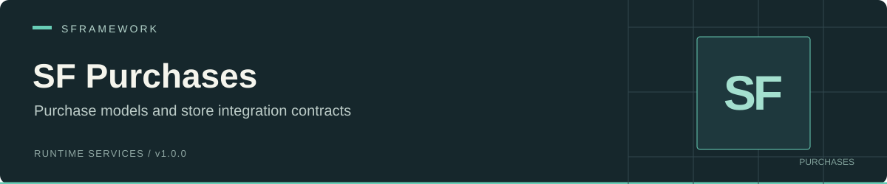

# SF Purchases

 

## Overview

SF Purchases provides config-defined product models and a purchase-service interface. Register `SFMockPurchasesService` for sandbox purchases with fixed price and currency metadata. Existing `SFPurchasesService` registrations use the same simulation.

## Requirements

The [manifest](package.json) declares no dependencies or minimum Unity version. Install the dependencies required by the [runtime assembly](Runtime/SFramework.Purchases.Runtime.asmdef):

| Requirement | Purpose |
| --- | --- |
| [SF Core](https://github.com/huran438/sf-core) | Service lifecycle, registration, and injection. |
| [SF Configs](https://github.com/huran438/sf-configs) | Configuration loading, node IDs, and models. |
| [UniTask](https://github.com/Cysharp/UniTask) | Async initialization and purchase return values. |
| Newtonsoft.Json (`Newtonsoft.Json.dll`) | Explicit runtime DLL reference and SF Configs dependency. |
| [SF Debug](https://github.com/huran438/sf-debug) | Transitive assembly dependency of SF Core. |

Reference `SFramework.Purchases.Runtime` and the SF assemblies used by your code. This package has no package-specific scripting define requirement. A store SDK is not used by the supplied implementation. Choose an editor compatible with the installed dependencies and current C# syntax; SF Core uses `destroyCancellationToken`.

## Installation

In Unity Package Manager, choose **Add package from git URL** and enter:

```text
https://github.com/huran438/sf-purchases.git#main
```

Install the requirements separately; the manifest does not install them.

## Quick start

Save this JSON TextAsset as `Assets/Resources/SFramework/Purchases.json`. Keep `Type` first because SF Configs identifies a config by its first or last JSON property:

```json
{
  "Type": "SFPurchasesConfig",
  "Id": "shop",
  "Version": 1,
  "Purchases": [
    {
      "Id": "coins",
      "StoreId": "coins_100",
      "ProductType": 0
    }
  ]
}
```

The node's full ID is `shop/coins`. Save this class as `PurchasesContext.cs` and add it to the startup scene. Register Configs first so it finishes loading before Purchases initializes:

```csharp
using System.Threading;
using Cysharp.Threading.Tasks;
using SFramework.Configs.Runtime;
using SFramework.Core.Runtime;
using SFramework.Purchases.Runtime;
using UnityEngine;

public sealed class PurchasesContext : SFContextRoot
{
    protected override void PreInit() { }

    protected override void Bind()
    {
        SFContainer.Register<ISFConfigsService, SFConfigsService>();
        SFContainer.Register<ISFPurchasesService, SFMockPurchasesService>();
    }

    protected override async UniTask Init(CancellationToken cancellationToken)
    {
        var purchases = SFContainer.Resolve<ISFPurchasesService>();
        var result = await purchases.PurchaseAsync("shop/coins", cancellationToken);
        Debug.Log($"Stub purchase status: {result.Status}");
    }
}
```

Other controllers can await `context.WaitForInitialization()` before using the registered service. Replace the stub with your own `ISFPurchasesService` implementation when connecting a real store and entitlement system.

## API

Runtime namespace: `SFramework.Purchases.Runtime`. [`ISFPurchasesService`](Runtime/ISFPurchasesService.cs) extends `ISFService`.

| API | Supplied behavior |
| --- | --- |
| `Init(CancellationToken)` / `Dispose()` | Publish validated product models on successful initialization or clear them on disposal. |
| `PurchaseAsync(string productFullId, CancellationToken ct = default)` | Returns `Canceled` if cancellation was requested, `Confirmed` for a known full ID, and `Failed` with `Unknown product` for a blank or unknown ID. |
| `RestoreTransactions(Action<bool, string> callback = null)` | Immediately invokes the callback with `true, null`. |
| `TryGetProduct(string productFullId, out SFPurchaseModel model)` | Looks up a configured model. |
| `Models` / `IsReady(string productFullId)` | Enumerates models or checks whether the ID exists. |
| `GetLocalizedTitle`, `GetLocalizedPrice`, `GetIsoCurrency` | Returns the model metadata, or an empty string for an unknown ID. |
| `SFPurchasesConfig.Purchases` / `SFPurchaseNode` | Product nodes with `StoreId`, `ProductType`, and Google/Apple/Huawei/Yandex/Xsolla ID fields. |
| `SFPurchaseAttribute` | SF Configs inspector selector for purchase IDs. |
| `SFCurrencyUtils.GetCurrencySymbol(string currencyCode, bool preferLocalized = false)` | Resolves and caches a currency symbol using cultures and fallbacks; unknown codes return uppercase text. |

`SFPurchaseModel` holds its config node, readiness, title, localized price string, and ISO currency code. `SFPurchaseResult` exposes `Status`, `FullId`, `StoreId`, `TransactionId`, `Receipt`, and `FailureReason`. Read `Success` for confirmation. It requires a constructed result with status `Confirmed` and returns false for the default value. Status values are `Confirmed`, `Failed`, `Deferred`, and `Canceled`. Product types are `Consumable`, `NonConsumable`, `Subscription`, and `Unknown`.

## Behavior and limitations

- Initialization assigns every unique full ID `Ready = true`, title equal to `StoreId`, price `99.99`, and currency `USD`. Duplicate full IDs keep the first model. Lookups use case-sensitive ordinal IDs.
- Configs need IDs, non-null product lists, and valid product IDs. Failed or canceled initialization preserves the previous product catalog. A simulated confirmation has no store ID, transaction ID, or receipt.
- Restore reports success without querying ownership, restoring entitlements, or enumerating transactions. No inventory grant, persistence, subscription validation, receipt/signature verification, or server validation is supplied.
- The internal Android receipt parser extracts receipt fields; it is not a store adapter or proof of purchase.
- With `preferLocalized`, each lookup uses the current culture's currency symbol when its ISO code matches. Other lookups share a case-insensitive fallback cache. Retain the ISO code when an unambiguous currency identifier is needed.

## Tests

Package tests are in [Tests/Editor](Tests/Editor) and use the `SFramework.Purchases.Editor.Tests` assembly. Install Unity Test Framework (`com.unity.test-framework`) in the host project. Test assemblies are Editor-only and gated by `UNITY_INCLUDE_TESTS`.

Add `sp.sframework.purchases` to the top-level `testables` array in the host project's `Packages/manifest.json`, preserving its dependencies and any existing testable entries:

```json
{
  "testables": ["sp.sframework.purchases"]
}
```

Open **Window > General > Test Runner**, select **EditMode**, and run `SFramework.Purchases.Editor.Tests`. The `sf-demo` host enables all SFramework package tests in its manifest.

The suite tests local product/result, receipt parsing, and currency behavior. It cannot validate real payments, store SDK callbacks, restoration, receipt authenticity, or platform store policies because the supplied service has no store integration.

## License

MIT. See [LICENSE.md](LICENSE.md) for the terms.
